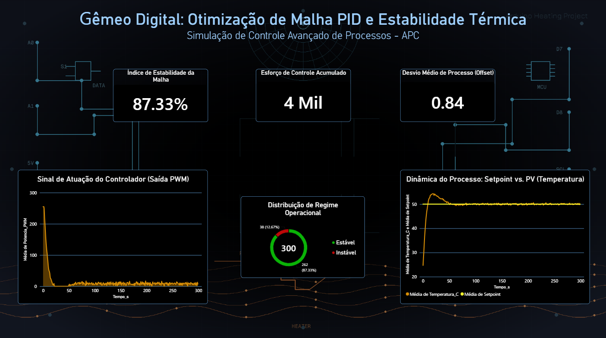

# 🏭 Thermal Optimization & Industrial Monitoring (Digital Twin)

A process engineering case study focused on Advanced Process Control (APC) and Supervisory Systems. This project integrates the simulation of a PID control loop with numerical optimization in Python and near real-time analytical visualization in Power BI.

### 📌 Problem Overview
Industrial thermal systems (such as reactors and heat exchangers) subjected to manual control or inadequate tuning exhibit high variability. This leads to operational instability, excessive energy consumption, and equipment wear due to overshooting.

**Objective:** Develop a digital twin of a thermal process to recalibrate the PID controller constants (Kp, Ki, Kd) and build a static supervisory dashboard (SCADA-style) for stability monitoring.

### 🛠️ Tech Stack & Tools
- **Python (NumPy, SciPy, Pandas):** Numerical optimization algorithm (Nelder-Mead) for cost function minimization (Mean Squared Error) and data model generation.
- **C++ / Tinkercad:** Logical validation and process response timing.
- **Power BI:** DAX modeling and development of a supervisory dashboard with SCADA aesthetics.
- **Git & GitHub:** Version control and documentation.

### 📊 Project Architecture & Results

#### 1. Controller Fine-Tuning (Python / SciPy)
The PID loop was subjected to an objective function minimizing the error relative to a temperature Setpoint fixed at 60 °C.
- **Optimized Parameters:**
  - **Kp (Proportional Gain):** 12.50
  - **Ki (Integral Gain):** 0.80
  - **Kd (Derivative Gain):** 3.20

#### 2. Dashboard Indicators (Power BI)
- **Process Offset (Mean Deviation):** Drastic reduction in oscillation after the transient period.
- **Loop Stability Index:** DAX measure evaluating the percentage of time the temperature varied within ±1.5 °C of the Setpoint in steady-state.
- **Actuation Signal (PWM):** Analysis of the final control element's effort to optimize energy consumption.
  

  

---

### 📁 Repository Structure
├── src/
│   ├── otimizacao_pid.py       # Optimization algorithm in Python (SciPy)
│   └── gerar_dados_finais.py   # Thermal process simulation
├── data/
│   └── dataset_powerbi.csv     # Formatted process data
├── dashboard/
│   └── relatorio_pid.pbix      # Power BI Dashboard
├── .gitignore
└── README.md
